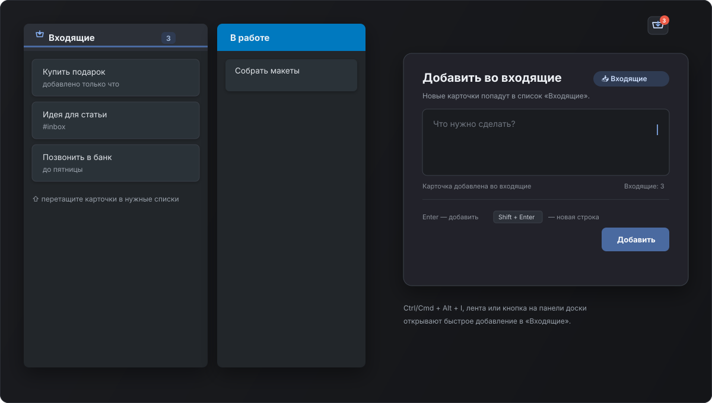
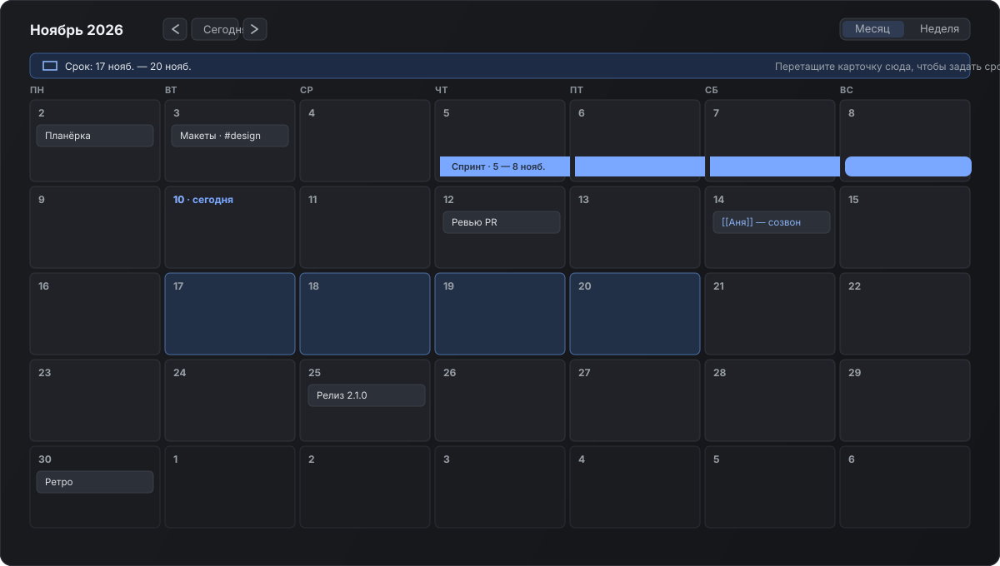

# Kanban Plus

[Русский](./README.md) · **English**

Kanban Plus is a fork of [Obsidian Kanban](https://github.com/mgmeyers/obsidian-kanban). Boards stay plain markdown files and still open in the original plugin.


## Features

- **Colored lanes & cards.** Header/body tint for lanes, strip or full background for cards, palette and custom color. Stored in the `%% kanban:settings` block.
- **Backgrounds, text and fonts.** Board, lane and card backgrounds: color, gradient, an image from the vault, a URL or a local file. Text color and font per board, lane or card; the default font lives in plugin settings.
- **Labels.** A colored bar above the card expands to the label name on click and collapses on the next click. Existing tags and tag colors are kept.
- **Tags & filters.** Colored tags, quick filter bar (tags, “Overdue”, “Today”, “Next 7 days”) and a tags submenu on cards.
- **Free-floating lanes.** Drag a lane out of the row and leave it anywhere on the board. The magnet button or a click on its background smoothly snaps it back.
- **Inbox.** A dedicated Inbox list for quick capture: toolbar button, ribbon action or `Ctrl/Cmd + Alt + I`, a card-count badge and one-click triage.
- **Deadlines & periods.** Not just a due date, but a “from → to” range with semantic badge colors.
- **Calendar planner.** Month and week views, drag & drop cards between days, an “Unscheduled” panel, and drag-select to create a period.
- **Checklists.** A `2/5` progress counter with a bar right on the card.
- **Card window.** Clicking a card opens a window with description, checklist, per-item comments and a comment/event feed, with a smooth appearance animation.
- **Animations.** Card hover lift, drag physics, FLIP transitions for lanes, respects `prefers-reduced-motion`.
- **Board zoom.** `Ctrl + wheel` / `Cmd + wheel`, two-finger pinch, and `− / % / +` controls (40–200%).

## Installation

**BRAT:** add `ZekiTRR/Kanban-plus` to [BRAT](https://github.com/TfTHacker/obsidian42-brat) and install the plugin.

**Manual:**

1. Download `main.js`, `manifest.json` and `styles.css` from the [latest release](https://github.com/ZekiTRR/Kanban-plus/releases/latest).
2. Put them into `<vault>/.obsidian/plugins/obsidian-kanban-plus/`.
3. Enable **Kanban Plus** in Obsidian settings.

> The plugin uses `id: obsidian-kanban-plus`, so don’t enable it together with the original `obsidian-kanban`.

## Appearance

- **Board background:** palette icon in the toolbar → “Board background”.
- **Lane / card background:** list or card menu → “Lane background” / “Card background”. Pick a color, a gradient (presets or custom CSS) or an image — from the vault, a URL or a local file; images have a dimming control.
- **Text color:** “Text color” in the lane or card menu — palette and custom color with a live preview.
- **Fonts:** the same menus have “Lane / Card / Board font”. The global default is in plugin settings: Kanban Plus → “Default font”.
- **Collapse all lists:** toolbar icon or the Appearance menu entry.

## Card window

Clicking a card opens a detail window (links inside the card still work as links):

- change the list (status);
- description;
- checklist with per-item comments;
- comments and events;
- quick actions: “Add”, “Labels”, “Dates”, “Checklist”;
- the “Labels” panel lets you assign existing labels, create new ones and change their colors right there.

The “Open card” context-menu item is always available.

## Periods

Open a card’s menu and choose **“Set period”**, then pick the start and end days. The card shows a `Feb 5 – Feb 10` badge:

- accent — the period is in progress;
- red — overdue;
- green — the card is done.

The period is stored in markdown as Tasks emoji dates (start and due date in `YYYY-MM-DD` format), so files stay compatible with Tasks and the original Kanban.


## Inbox

The **“Inbox”** button in the board toolbar (with a card-count badge), the ribbon action or `Ctrl/Cmd + Alt + I` open quick capture. `Enter` adds a card, `Shift + Enter` inserts a line; every non-empty line becomes its own card, so you can paste a whole list at once.

The Inbox list is created automatically on first use and is placed first. Its menu offers “Move all cards to…” and “Hide inbox”, and any card’s menu has “Move to inbox”. Both the feature and the list name are configurable in board settings.



## Calendar

Switch the board view to **calendar** (view menu or the “View as calendar” command).

- Drop a card on a day to move its date (or the whole period).
- Drag across several days, then drop a card into the selection to create a period.
- The “Unscheduled” panel clears dates.
- Right-click a card for period, date, archive and delete actions.



## Compatibility

- The `kanban-plugin` key and card syntax are unchanged.
- New settings live in `%% kanban:settings`; the original plugin simply ignores them.
- Tasks emoji dates are parsed without the Tasks plugin.

## Development

```bash
npm install
npm run dev     # watch build
npm run build   # production build
```

Sources live in `src/` and build into `main.js` and `styles.css`.

## License

GPL-3.0. Based on [obsidian-kanban](https://github.com/mgmeyers/obsidian-kanban) © mgmeyers.
