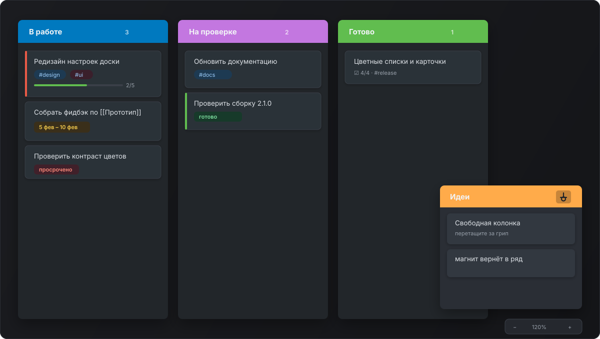
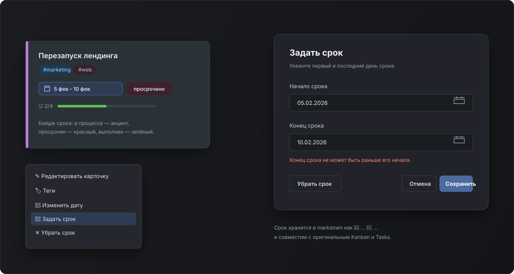

# Kanban Plus

[Русский](./README.md) · **English**

Kanban Plus is a fork of [Obsidian Kanban](https://github.com/mgmeyers/obsidian-kanban) with ideas from Trello, Plaky, Planka and Notion. Boards stay plain markdown files and still open in the original plugin.



## Features

- **🎨 Colored lanes & cards.** Header/body tint for lanes, strip or full background for cards, palette and custom color. Stored in the `%% kanban:settings` block.
- **🏷 Tags & filters.** Colored tags, quick filter bar (tags, “Overdue”, “Today”, “Next 7 days”) and a tags submenu on cards.
- **📌 Free-floating lanes.** Drag a lane out of the row and leave it anywhere on the board. The magnet button or a click on its background smoothly snaps it back.
- **🗓 Deadlines & periods.** Not just a due date, but a “from → to” range with semantic badge colors.
- **📅 Calendar planner.** Month and week views, drag & drop cards between days, an “Unscheduled” panel, and drag-select to create a period.
- **✅ Checklists.** A `☑ 2/5` progress counter with a bar right on the card.
- **✨ Animations.** Card hover lift, drag physics, FLIP transitions for lanes, respects `prefers-reduced-motion`.
- **🔍 Board zoom.** `Ctrl + wheel` / `Cmd + wheel`, two-finger pinch, and `− / % / +` controls (40–200%).

## Installation

**BRAT:** add `ZekiTRR/Kanban-plus` to [BRAT](https://github.com/TfTHacker/obsidian42-brat) and install the plugin.

**Manual:**

1. Download `main.js`, `manifest.json` and `styles.css` from the [latest release](https://github.com/ZekiTRR/Kanban-plus/releases/latest).
2. Put them into `<vault>/.obsidian/plugins/obsidian-kanban-plus/`.
3. Enable **Kanban Plus** in Obsidian settings.

> The plugin uses `id: obsidian-kanban-plus`, so don’t enable it together with the original `obsidian-kanban`.

## Periods

Open a card’s menu and choose **“Set period”**, then pick the start and end days. The card shows a `Feb 5 – Feb 10` badge:

- accent — the period is in progress;
- red — overdue;
- green — the card is done.

The period is stored in markdown as `🛫 YYYY-MM-DD … 📅 YYYY-MM-DD`, so files stay compatible with Tasks and the original Kanban.



## Calendar

Switch the board view to **calendar** (view menu or the “View as calendar” command).

- Drop a card on a day to move its date (or the whole period).
- Drag across several days, then drop a card into the selection to create a period.
- The “Unscheduled” panel clears dates.
- Right-click a card for period, date, archive and delete actions.


## Compatibility

- The `kanban-plugin` key and card syntax are unchanged.
- New settings live in `%% kanban:settings`; the original plugin simply ignores them.
- Tasks emoji dates (`🛫`, `📅`, `✅`) are parsed without the Tasks plugin.

## Development

```bash
npm install
npm run dev     # watch build
npm run build   # production build
```

Sources live in `src/` and build into `main.js` and `styles.css`.

## License

GPL-3.0. Based on [obsidian-kanban](https://github.com/mgmeyers/obsidian-kanban) © mgmeyers.
