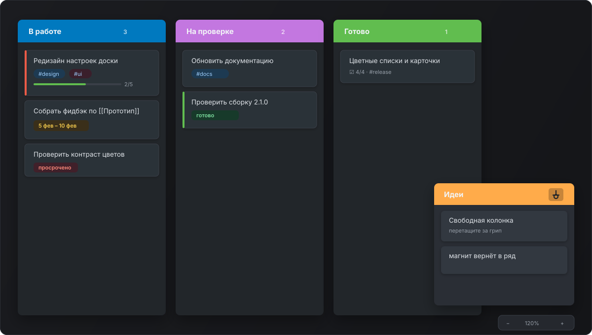
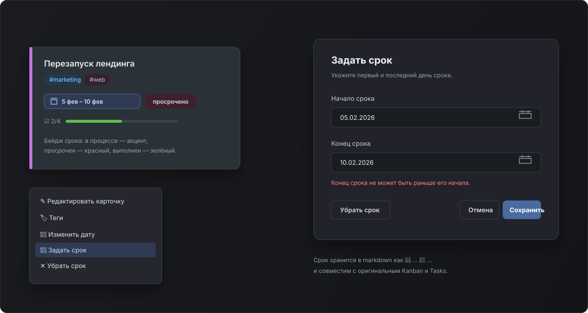
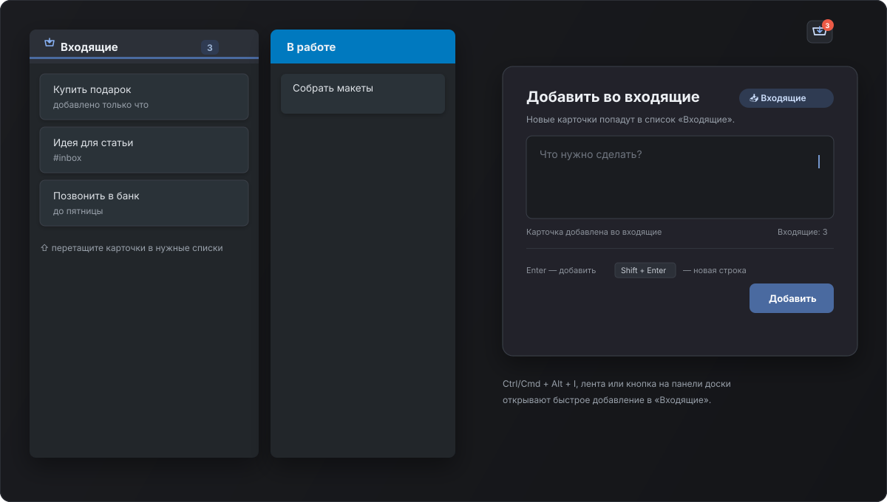
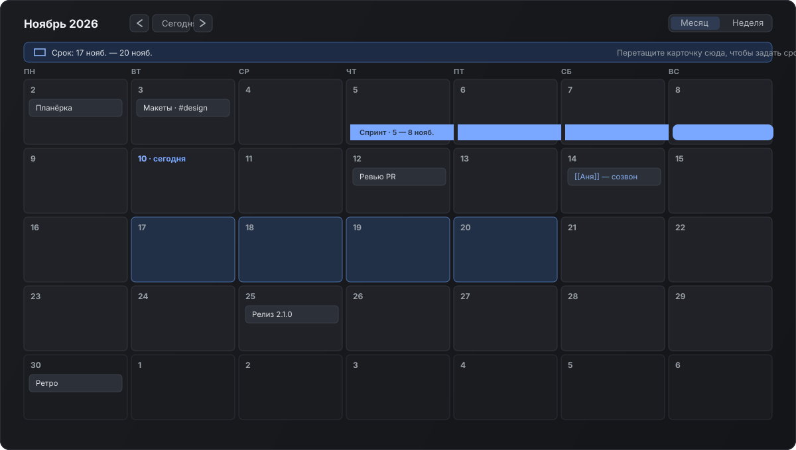

# Kanban Plus

**Русский** · [English](./README.en.md)

Kanban Plus — форк [Obsidian Kanban](https://github.com/mgmeyers/obsidian-kanban) с фишками из Trello, Plaky, Planka и Notion. Доски остаются обычным markdown-файлом и открываются оригинальным плагином.



## Возможности

- **🎨 Цветные списки и карточки.** Цвет шапки и фона списка, полоса или фон карточки, палитра и свой цвет. Всё хранится в блоке `%% kanban:settings`.
- **🖼 Фон, текст и шрифты.** Фон доски, списка и карточки: цвет, градиент, изображение из хранилища, по ссылке или с локального диска. Цвет текста и шрифт — для доски, списка или карточки; шрифт по умолчанию задаётся в настройках плагина.
- **🏷 Метки в стиле Trello.** Над карточкой — цветная полоса метки; клик раскрывает название, повторный клик сворачивает. Старые теги и их цвета сохранены.
- **🏷 Теги и фильтры.** Теги с цветами, панель быстрых фильтров (теги, «Просрочено», «Сегодня», «7 дней») и подменю тегов в карточке.
- **📌 Свободные списки.** Список можно вытащить из ряда и оставить плавать в любом месте доски. Кнопка-магнит или клик по фону плавно возвращает его в ряд.
- **📥 Inbox как в Trello.** Отдельный список «Входящие» для быстрого захвата: кнопка на панели, лента или `Ctrl/Cmd + Alt + I`, бейдж с количеством и разбор карточек по спискам.
- **🗓 Сроки (периоды).** Не только дедлайн, но и диапазон «с какого по какое» с семантической подсветкой бейджа.
- **📅 Календарь-планировщик.** Месяц и неделя, drag-and-drop карточек по дням, панель «Без даты», создание срока протяжкой по дням.
- **✅ Чек-листы.** Прогресс `☑ 2/5` с полосой прямо на карточке.
- **🗂 Карточка как в Trello.** Клик по карточке открывает окно с описанием, чек-листом, комментариями к пунктам и лентой комментариев/событий — с плавной анимацией появления.
- **✨ Анимации.** Подъём карточки, физика перетаскивания, FLIP-переходы списков, `prefers-reduced-motion`.
- **🔍 Масштаб доски.** `Ctrl + колесо` / `Cmd + колесо`, щипок двумя пальцами, кнопки `− / % / +` (40–200%).

## Установка

**BRAT:** добавьте репозиторий `ZekiTRR/Kanban-plus` в [BRAT](https://github.com/TfTHacker/obsidian42-brat) и установите плагин.

**Вручную:**

1. Скачайте `main.js`, `manifest.json`, `styles.css` из [последнего релиза](https://github.com/ZekiTRR/Kanban-plus/releases/latest).
2. Положите их в `<vault>/.obsidian/plugins/obsidian-kanban-plus/`.
3. Включите **Kanban Plus** в настройках Obsidian.

> Плагин использует `id: obsidian-kanban-plus`, поэтому не включайте одновременно с оригинальным `obsidian-kanban`.

## Оформление

- **Фон доски:** иконка палитры на панели → «Фон доски».
- **Фон списка / карточки:** меню списка или карточки → «Фон списка» / «Фон карточки». Можно выбрать цвет, градиент (пресеты или свой CSS) или изображение — из хранилища, по URL или с локального диска; для изображений есть затемнение.
- **Цвет текста:** «Цвет текста» в меню списка или карточки; палитра и свой цвет, с живым предпросмотром.
- **Шрифт:** «Шрифт списка / карточки / доски». Общий шрифт по умолчанию — Настройки → Kanban Plus → «Шрифт по умолчанию».
- **Свернуть все списки:** иконка на панели доски или пункт в меню оформления.

## Карточка

Клик по карточке открывает окно в духе Trello (ссылки внутри карточки продолжают работать как ссылки):

- смена списка (статуса);
- описание;
- чек-лист с комментариями к пунктам;
- комментарии и события, кнопка «Показать подробности»;
- быстрые действия: «Добавить», «Метки», «Даты», «Чек-лист»;
- в панели «Метки» можно назначать существующие метки, создавать новые и сразу менять их цвета.

Пункт «Открыть карточку» в контекстном меню доступен всегда.

## Сроки

В меню карточки выберите **«Задать срок»** и укажите начало и конец. На карточке появится бейдж `5 фев – 10 фев`:

- акцент — срок идёт сейчас;
- красный — просрочен;
- зелёный — карточка выполнена.

Срок хранится в markdown как `🛫 YYYY-MM-DD … 📅 YYYY-MM-DD`, поэтому файл остаётся совместимым с Tasks и оригинальным Kanban.



## Inbox

Кнопка **«Входящие»** на панели доски (с бейджем количества), лента или `Ctrl/Cmd + Alt + I` открывают быстрое добавление. `Enter` — добавить, `Shift + Enter` — новая строка; каждая непустая строка становится отдельной карточкой, так что можно вставить список дел сразу.

Список «Входящие» создаётся автоматически при первом добавлении и встаёт первым. В меню списка есть «Переместить все карточки в…» и «Скрыть входящие», а в меню карточки — «Переместить во входящие». Название списка и сам Inbox настраиваются в настройках доски.



## Календарь

Переключите вид доски на **календарь** (иконка вида или команда «View as calendar»).

- Бросьте карточку на день — дата (или весь срок) перенесётся.
- Протяните мышь по нескольким дням и бросьте в выделение карточку — получите срок.
- Панель «Без даты» сбрасывает даты.
- ПКМ по карточке — срок, дата, архив, удаление.



## Совместимость

- Ключ `kanban-plugin` и синтаксис карточек не менялись.
- Новые настройки пишутся в `%% kanban:settings`; оригинальный плагин их просто игнорирует.
- Эмодзи-даты Tasks (`🛫`, `📅`, `✅`) разбираются без установленного Tasks.

## Разработка

```bash
npm install
npm run dev     # сборка с watch
npm run build   # production-сборка
```

Изменения — в `src/`, собираются в `main.js` и `styles.css`.

## Лицензия

GPL-3.0. Основано на [obsidian-kanban](https://github.com/mgmeyers/obsidian-kanban) © mgmeyers.
